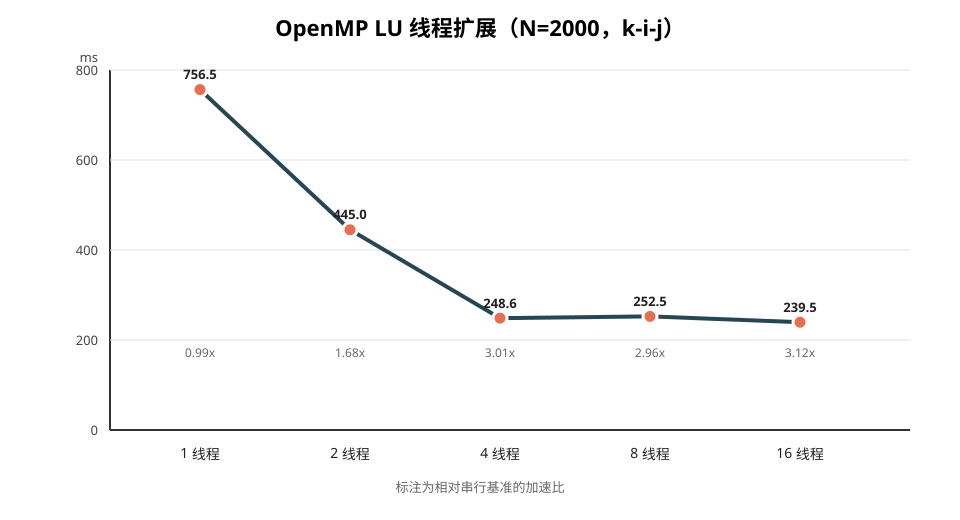
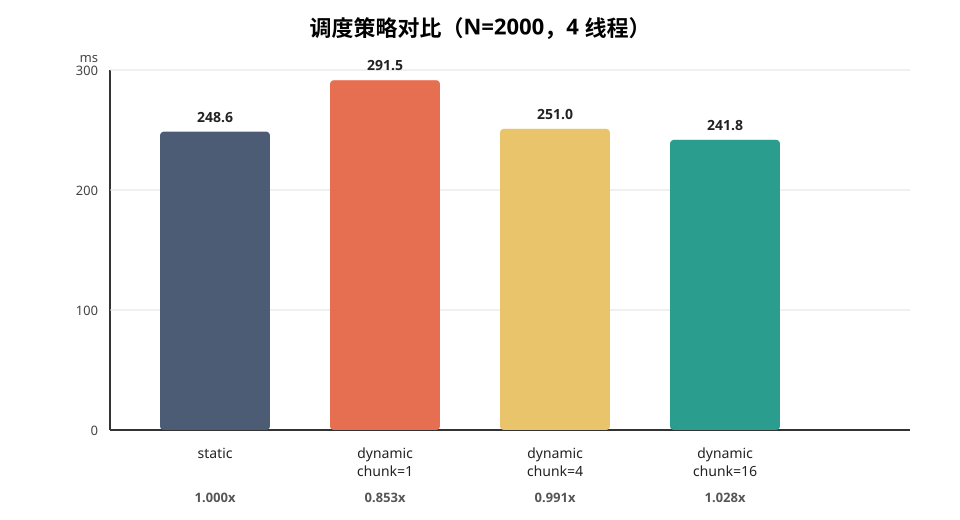
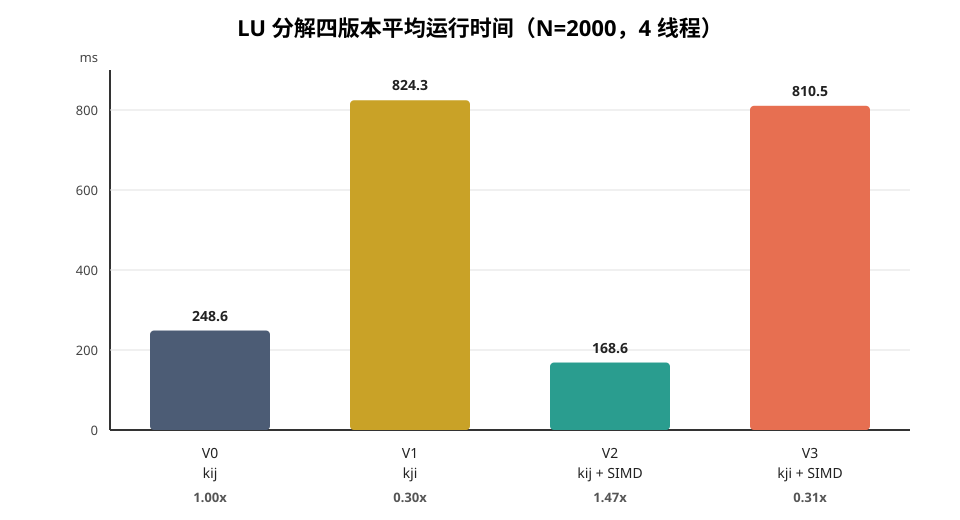
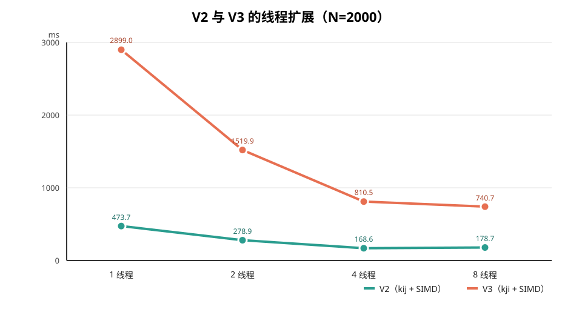

# LU 分解的 OpenMP 并行与性能优化实验报告

## 1 实验目的

本实验以 LU 分解为对象，对它进行并行化和性能优化。实验分为两个阶段：第一阶段分析三层循环的数据依赖，确定可并行部分，使用 OpenMP 将串行程序并行化，并考察线程数对加速比和并行效率的影响；第二阶段在并行版本基础上，考察循环顺序、SIMD 向量化和调度策略对性能的影响，并通过 2×2 因子设计分析各因素的主效应与交互作用。

## 2 LU 分解与并行化基础

### 2.1 输入、输出与 packed 结果格式

程序对输入方阵进行原地分解，原始矩阵 `A` 在计算过程中被逐步更新，最终被 `L` 与 `U` 覆盖。为节省空间，结果采用 packed 格式保存：

```text
C[i][j] = U[i][j]，当 i <= j
C[i][j] = L[i][j]，当 i >  j
```

其中 `L` 的对角线隐含为 1，不单独存储。

正确性通过串行参考结果检验：程序先由 `serial_lu_kij` 对相同输入生成 packed LU，再将待测算法的工作矩阵与其逐元素比较。这样既能检查循环交换是否改变了计算逻辑，也能发现并行调度引入的数据竞争。

### 2.2 串行分解过程

串行算法按 `k = 0, 1, ..., N-1` 逐列消元。第 `k` 步以 `A[k][k]` 为主元，完成两件事：

1. 对每一行 `i > k`，计算乘子并存回 `A[i][k]`；
2. 用乘子更新右下角的子矩阵，即 `A[i][j] -= A[i][k] * A[k][j]`，其中 `i, j > k`。

随着 `k` 递增，待更新的子矩阵不断缩小，这正是 LU 分解计算量呈 `O(N³)` 而并行规模逐步收缩的原因。程序在计时之外复制原始矩阵，因此每次运行都从相同的输入开始。

### 2.3 输入数据

程序根据种子确定性地生成强对角占优方阵。`--seed` 必须由恰好 8 个大写字母组成，例如 `ABCDEFGH`；未指定时程序自动生成并打印种子，便于复现。

矩阵生成规则如下：

1. 非对角元素从 `[-0.5, 0.5]` 范围内确定性生成；
2. 对每一行计算非对角元素绝对值之和；
3. 将对角元素设置为该绝对值之和加 `1.0`。

因此每一行满足：

```text
|A[i][i]| > Σ(j != i) |A[i][j]|
```

严格对角占优降低了无主元 LU 分解出现零主元的风险。

## 3 依赖分析与并行策略

### 3.1 三层循环与 k 的循环携带依赖

```text
for k = 0 ... N-1
    pivot = A[k][k]
    for i = k+1 ... N-1
        A[i][k] /= pivot
        for j = k+1 ... N-1
            A[i][j] -= A[i][k] × A[k][j]
```

`k` 循环存在循环携带依赖：第 `k+1` 步读取的 `A[k+1][k+1]` 等元素是第 `k` 步更新后的结果。若把不同 `k` 分给不同线程，就会出现“读到旧数据”的错误。因此 `k` 必须串行执行。

固定 `k` 之后，不同的 `i` 行只读写各自的 `A[i][*]`，以及共享只读的主元行 `A[k][*]`，行与行之间没有写冲突。

### 3.2 i 与 j 的并行性比较

固定 `k` 后，`i` 循环和 `j` 循环都可以并行，但两者的代价不同：

- 并行 `i`：每个线程负责若干整行，沿行方向连续访问；乘子 `A[i][k]` 与更新数据在同一行内，局部性好。
- 并行 `j`：每个线程负责若干列，但必须在乘子全部计算完成后才能更新，且内层 `i` 方向跨越整行，访存不连续。

### 3.3 选择并行 i、串行 j 的依据

本实验选择并行 `i`、串行 `j`。让一个线程负责一整行的更新，任务粒度适中：单个任务包含足够多的浮点运算，可以摊薄调度开销；不同线程写入不同行，不存在数据竞争；内层 `j` 循环连续访问，也为后续的 Cache 优化和 SIMD 留出了空间。

### 3.4 并行规模随 k 收缩

第 `k` 步可并行的行数为 `N-k-1`。当 `k` 接近 `N` 时，剩余行数很少，部分线程无事可做，而每个 `k` 仍需一次工作共享同步。这是 LU 并行效率随线程数增加而下降的结构性原因。

### 3.5 任务划分与静态分块

OpenMP 的 `schedule(static)` 把 `i` 的迭代区间划分为连续块并静态分配给各线程。静态调度没有运行时任务分配开销，适合各次迭代计算量相近的场景。对于 `N=2000` 的矩阵，单个 `k` 的可行数很大，静态划分能够保持较好的负载均衡；只有 `k` 接近末尾、剩余行数小于线程数时，才会出现明显的线程空闲。

## 4 算法实现

### 4.1 串行版本

`serial_lu_kij` 直接实现三层循环，内层 `j` 连续访问 `A[i][j]` 和主元行 `A[k][j]`，具有较好的空间局部性。

`serial_lu_kji` 交换 `i`、`j` 更新循环的顺序。交换之前必须先计算当前 `k` 对应的全部乘子，否则更新过程会读取尚未除以主元的 `A[i][k]`：

```text
for k = 0 ... N-1
    pivot = A[k][k]
    for i = k+1 ... N-1
        A[i][k] /= pivot
    for j = k+1 ... N-1
        for i = k+1 ... N-1
            A[i][j] -= A[i][k] × A[k][j]
```

该版本的内层 `i` 循环按列访问行优先矩阵，连续两次访问相隔一整行。两个串行版本用于在无并行干扰的条件下单独考察循环顺序对效率的影响。

### 4.2 OpenMP 版本

`openmp_lu_kij` 保持 `k` 循环串行，在固定 `k` 后并行处理 `i` 行，`j` 循环保持串行，并行循环使用静态调度：

```text
for k = 0 ... N-1
    parallel for i = k+1 ... N-1（static）
        A[i][k] /= A[k][k]
        for j = k+1 ... N-1
            A[i][j] -= A[i][k] × A[k][j]
```

`openmp_lu_kji` 先并行计算当前列的全部乘子，等待隐式同步完成后，再并行分配 `j` 列：

```text
for k = 0 ... N-1
    parallel for i = k+1 ... N-1（static）
        A[i][k] /= A[k][k]
    parallel for j = k+1 ... N-1（static）
        for i = k+1 ... N-1
            A[i][j] -= A[i][k] × A[k][j]
```

两种实现都使用静态调度和相同线程数，但 `openmp_lu_kji` 的内层访问跨越矩阵行，同时每个 `k` 比 `openmp_lu_kij` 多一次工作共享同步。

### 4.3 SIMD 版本

`openmp_lu_kij_simd` 保持 `openmp_lu_kij` 的循环结构和索引表达式不变，只在连续的 `j` 循环前添加 `omp simd`：

```text
parallel for i = k+1 ... N-1（static）
    A[i][k] /= A[k][k]
    simd for j = k+1 ... N-1
        A[i][j] -= A[i][k] × A[k][j]
```

`openmp_lu_kji_simd` 保持 `openmp_lu_kji` 的循环组织，在最内层 `i` 循环上添加 `omp simd`：

```text
parallel for j = k+1 ... N-1（static）
    upper = A[k][j]
    simd for i = k+1 ... N-1
        A[i][j] -= A[i][k] × upper
```

前者的向量化对象是连续访问的 `j` 循环，后者则是跨行访问的 `i` 循环。两个版本分别与对应的无 SIMD 版本构成单一变量对照。

### 4.4 动态调度版本

`openmp_lu_dynamic` 与 `openmp_lu_kij` 的循环结构相同，但把 `i` 循环改为 `schedule(dynamic, chunk)`。线程在完成一个任务块后主动领取下一个任务块，用于考察负载分配方式对性能的影响。

## 5 实验方法

### 5.1 实验环境

| 项目 | 配置 |
| --- | --- |
| 操作系统 | macOS 26.5.1（Build 25F80） |
| 处理器 | Apple M5 Pro，15 个物理/逻辑核心 |
| 内存 | 24 GiB |
| 编译器 | GCC 16.2.0 |
| 编译选项 | `-O2 -Wall -Wextra` |
| 矩阵规模 | `N = 2000` |
| 输入种子 | `ABCDEFGH` |
| 重复次数 | 每项 5 次，取平均值 |

### 5.2 实验设计

实验分为三组，所有组别使用相同的输入、编译器选项和测量流程。

| 组别 | 目的 | 配置 |
| --- | --- | --- |
| A 线程扩展 | 并行化收益 | `openmp_lu_kij`，1、2、4、8、16 线程 |
| B 调度策略 | 静态与动态调度的差异 | 4 线程，static、dynamic（chunk=1、4、16） |
| C 优化实验 | 循环顺序与 SIMD 的主效应及交互 | 4 线程，V0–V3；V2、V3 另测 1、2、4、8 线程 |

优化实验采用 2×2 因子设计：

| 版本 | 循环顺序 | SIMD | 程序模块 | 设计目的 |
| --- | --- | --- | --- | --- |
| V0 | `k-i-j` | 否 | `openmp_lu_kij` | 基准 |
| V1 | `k-j-i` | 否 | `openmp_lu_kji` | 单独观察循环顺序变化 |
| V2 | `k-i-j` | 是 | `openmp_lu_kij_simd` | 单独观察 SIMD |
| V3 | `k-j-i` | 是 | `openmp_lu_kji_simd` | 观察循环顺序与 SIMD 的组合 |

### 5.3 正确性验证

程序先验证正确性，再比较性能。每次算法运行结束后，工作矩阵与 `serial_lu_kij` 生成的参考结果逐元素比较，输出最大绝对误差与最大相对误差。本报告中的全部测试误差均为 0，验证结果为 `PASS`。

### 5.4 测量指标与复现命令

计时区间只覆盖 LU 消元过程，输入生成、矩阵复制、参考结果计算和正确性验证均在计时之外完成。每个配置连续运行 5 次取平均值。

线程扩展的加速比与并行效率以串行 `serial_lu_kij` 为基准：

```text
Speedup(p) = Time(serial) / Time(p)
Efficiency(p) = Speedup(p) / p
```

优化实验的加速比以 4 线程的 V0 为基准：

```text
Speedup(Vx) = Time(V0) / Time(Vx)
```

V2、V3 的扩展效率以各自单线程时间为基准：

```text
Efficiency(p) = Time(1) / (p × Time(p))
```

调度实验的加速比以同线程数的静态调度为基准。

完整复现命令如下：

```bash
# 构建
cmake -S . -B build -DCMAKE_C_COMPILER=/opt/homebrew/bin/gcc-16
cmake --build build

# A 组：串行基准与线程扩展
./build/bin/lu -m serial_lu_kij -n 2000 -r 5 --seed ABCDEFGH
./build/bin/lu -m serial_lu_kji -n 2000 -r 5 --seed ABCDEFGH
./build/bin/lu -m openmp_lu_kij -n 2000 -r 5 -t 1  --seed ABCDEFGH
./build/bin/lu -m openmp_lu_kij -n 2000 -r 5 -t 2  --seed ABCDEFGH
./build/bin/lu -m openmp_lu_kij -n 2000 -r 5 -t 4  --seed ABCDEFGH
./build/bin/lu -m openmp_lu_kij -n 2000 -r 5 -t 8  --seed ABCDEFGH
./build/bin/lu -m openmp_lu_kij -n 2000 -r 5 -t 16 --seed ABCDEFGH

# B 组：调度策略（4 线程）
./build/bin/lu -m openmp_lu_dynamic -n 2000 -r 5 -t 4 -c 1  --seed ABCDEFGH
./build/bin/lu -m openmp_lu_dynamic -n 2000 -r 5 -t 4 -c 4  --seed ABCDEFGH
./build/bin/lu -m openmp_lu_dynamic -n 2000 -r 5 -t 4 -c 16 --seed ABCDEFGH

# C 组：四版本综合实验（4 线程）
./build/bin/lu -m openmp_lu_kij      -n 2000 -r 5 -t 4 --seed ABCDEFGH
./build/bin/lu -m openmp_lu_kji      -n 2000 -r 5 -t 4 --seed ABCDEFGH
./build/bin/lu -m openmp_lu_kij_simd -n 2000 -r 5 -t 4 --seed ABCDEFGH
./build/bin/lu -m openmp_lu_kji_simd -n 2000 -r 5 -t 4 --seed ABCDEFGH

# C 组扩展：V2、V3 线程扩展
./build/bin/lu -m openmp_lu_kij_simd -n 2000 -r 5 -t 1 --seed ABCDEFGH
./build/bin/lu -m openmp_lu_kij_simd -n 2000 -r 5 -t 2 --seed ABCDEFGH
./build/bin/lu -m openmp_lu_kij_simd -n 2000 -r 5 -t 8 --seed ABCDEFGH
./build/bin/lu -m openmp_lu_kji_simd -n 2000 -r 5 -t 1 --seed ABCDEFGH
./build/bin/lu -m openmp_lu_kji_simd -n 2000 -r 5 -t 2 --seed ABCDEFGH
./build/bin/lu -m openmp_lu_kji_simd -n 2000 -r 5 -t 8 --seed ABCDEFGH
```

## 6 实验结果

### 6.1 串行基准与循环顺序

**表 1 串行基准与循环顺序对照（N=2000）**

| 对比内容 | 基准 | 对比版本 | 基准时间（ms） | 对比时间（ms） | 加速比 |
| --- | --- | --- | ---: | ---: | ---: |
| 串行条件下的循环顺序 | `serial_lu_kji` | `serial_lu_kij` | 2803.513 | 747.152 | 3.752 |
| `k-i-j` 的 OpenMP 收益 | `serial_lu_kij` | `openmp_lu_kij` | 747.152 | 248.617 | 3.005 |
| `k-j-i` 的 OpenMP 收益 | `serial_lu_kji` | `openmp_lu_kji` | 2803.513 | 824.286 | 3.401 |
| OpenMP 条件下的循环顺序 | `openmp_lu_kji` | `openmp_lu_kij` | 824.286 | 248.617 | 3.315 |

仅改变循环顺序，串行程序的时间就从 2803.513 ms 降至 747.152 ms，相差 3.752 倍；在 OpenMP 条件下，`k-i-j` 仍比 `k-j-i` 快 3.315 倍。两种顺序经并行化后分别获得 3.005 倍和 3.401 倍的加速，说明并行化并未改变循环顺序的相对优劣，循环顺序带来的差距也不会被多线程消除。

原始数据见 [`assets/lu_loop_order.csv`](assets/lu_loop_order.csv)。

### 6.2 OpenMP 线程扩展

**表 2 OpenMP 线程扩展结果（N=2000，k-i-j）**

| 线程数 | 第 1 次 | 第 2 次 | 第 3 次 | 第 4 次 | 第 5 次 | 平均（ms） | 加速比 | 并行效率 |
| ---: | ---: | ---: | ---: | ---: | ---: | ---: | ---: | ---: |
| 1 | 758.371 | 755.829 | 755.023 | 756.228 | 756.865 | 756.463 | 0.988 | 98.8% |
| 2 | 445.350 | 445.583 | 443.693 | 443.879 | 446.441 | 444.989 | 1.679 | 84.0% |
| 4 | 248.605 | 247.968 | 248.484 | 249.122 | 248.908 | 248.617 | 3.005 | 75.1% |
| 8 | 245.418 | 253.535 | 255.134 | 253.487 | 254.770 | 252.469 | 2.959 | 37.0% |
| 16 | 235.981 | 240.766 | 239.945 | 239.624 | 241.108 | 239.485 | 3.120 | 19.5% |

从 1 线程到 4 线程，运行时间从 756.463 ms 降至 248.617 ms，加速比达到 3.005，效率为 75.1%。8 线程反而略慢于 4 线程，16 线程只比 4 线程快约 3.8%，效率降至 19.5%。



原始数据见 [`assets/lu_thread_scaling.csv`](assets/lu_thread_scaling.csv)。

### 6.3 调度策略

**表 3 调度策略对比（N=2000，4 线程）**

| 调度方式 | chunk | 第 1 次 | 第 2 次 | 第 3 次 | 第 4 次 | 第 5 次 | 平均（ms） | 相对静态调度 |
| --- | ---: | ---: | ---: | ---: | ---: | ---: | ---: | ---: |
| static | — | 248.605 | 247.968 | 248.484 | 249.122 | 248.908 | 248.617 | 1.000 |
| dynamic | 1 | 289.498 | 290.475 | 291.806 | 293.996 | 291.683 | 291.492 | 0.853 |
| dynamic | 4 | 250.322 | 250.914 | 251.236 | 250.943 | 251.535 | 250.990 | 0.991 |
| dynamic | 16 | 242.481 | 242.283 | 242.451 | 240.886 | 240.927 | 241.806 | 1.028 |

chunk=1 的动态调度比静态调度慢 17.2%，说明任务过细时领取任务的开销不可忽略。chunk 增大到 4 后与静态调度基本持平，chunk=16 时比静态调度快约 2.8%。



原始数据见 [`assets/lu_schedule.csv`](assets/lu_schedule.csv)。

### 6.4 四版本优化实验

**表 4 四版本综合实验结果（N=2000，4 线程）**

| 版本 | 循环 | SIMD | 第 1 次 | 第 2 次 | 第 3 次 | 第 4 次 | 第 5 次 | 平均（ms） | 加速比 |
| --- | --- | --- | ---: | ---: | ---: | ---: | ---: | ---: | ---: |
| V0 | `k-i-j` | 否 | 248.605 | 247.968 | 248.484 | 249.122 | 248.908 | **248.617** | **1.000** |
| V1 | `k-j-i` | 否 | 832.775 | 834.834 | 833.428 | 814.426 | 805.965 | **824.286** | **0.302** |
| V2 | `k-i-j` | 是 | 171.095 | 168.651 | 169.445 | 166.706 | 167.184 | **168.616** | **1.474** |
| V3 | `k-j-i` | 是 | 809.326 | 814.714 | 812.252 | 808.884 | 807.095 | **810.454** | **0.307** |

除 V1 外，各版本五次结果的波动均低于 5%；V1 的波动约为 3.5%。原始数据见 [`assets/lu_optimization.csv`](assets/lu_optimization.csv)。



### 6.5 V2 与 V3 线程扩展

**表 5 V2 与 V3 的线程扩展结果（N=2000）**

| 版本 | 线程数 | 平均时间（ms） | 相对 V0 加速比 | 并行效率 |
| --- | ---: | ---: | ---: | ---: |
| V2 | 1 | 473.670 | 0.525 | 100.0% |
| V2 | 2 | 278.945 | 0.891 | 84.9% |
| V2 | 4 | 168.616 | 1.474 | 70.2% |
| V2 | 8 | 178.668 | 1.392 | 33.1% |
| V3 | 1 | 2899.030 | 0.086 | 100.0% |
| V3 | 2 | 1519.876 | 0.164 | 95.4% |
| V3 | 4 | 810.454 | 0.307 | 89.4% |
| V3 | 8 | 740.660 | 0.336 | 48.9% |

除 V3 的 8 线程配置外，其余配置的五次结果波动均低于 5%；V3 的 8 线程第 5 次出现 779 ms 的离群值，波动约为 6.8%。原始数据见 [`assets/lu_scaling.csv`](assets/lu_scaling.csv)。



## 7 结果分析

### 7.1 依赖关系与并行规模收缩

`k` 的循环携带依赖决定了并行只能发生在固定 `k` 之后。表 2 显示，1 线程时加速比仅为 0.988，与串行基本一致，说明并行框架本身的固定开销很小；2 线程达到 1.679，4 线程达到 3.005。

效率下降的直接原因是可并行行数 `N-k-1` 随 `k` 递减。前半段消元任务充足，线程利用率高；后半段剩余行数少于线程数，部分线程提前空闲，而每个 `k` 仍要执行一次工作共享同步。16 线程时这种结构性损失被放大，效率降至 19.5%。

### 7.2 调度策略的影响

静态调度把连续区间一次性分给各线程，没有运行时分配开销。在本实验中，单个 `k` 的可行数较大，静态划分已经足够均衡，因此它成为比较基准。

动态调度在 chunk=1 时最慢，原因是每个 `k` 大约产生 `N-k-1` 个任务，任务粒度只有一行更新，线程频繁领取任务和同步的代价超过了负载均衡带来的收益。chunk 增大后，领取次数成比例减少，chunk=4 时与静态调度基本持平。chunk=16 时略快于静态调度，说明合适的块大小可以在保留负载均衡能力的同时压低调度开销。

### 7.3 循环顺序与 Cache

对 SIMD 取平均后，`k-j-i` 的平均时间为 817.370 ms，`k-i-j` 为 208.617 ms，前者是后者的 3.918 倍。串行条件下这一比值为 3.752 倍，两者基本一致，说明差距来自访存模式而非并行开销。

`k-j-i` 的内层循环每次跨过一整行，单次访问只使用 64 字节 Cache line 中的 8 字节，连续访问带来的预取效果也随之失效。改变循环顺序没有减少浮点运算次数，却改变了数据的取用路径，因而带来数倍的性能差异。

### 7.4 SIMD 与交互作用

对循环顺序取平均后，启用 SIMD 的平均时间为 489.535 ms，未启用为 536.452 ms，整体提升约 9.6%。这一数字掩盖了两种循环顺序下的差异。

在 `k-i-j` 下，SIMD 将时间从 248.617 ms 降至 168.616 ms，加速 1.474 倍；在 `k-j-i` 下，时间从 824.286 ms 变为 810.454 ms，仅相差 1.7%，小于 V1 自身 3.5% 的测量波动，可以认为没有显著变化。也就是说，SIMD 的收益主要来自连续访问的版本。

`k-i-j` 的内层 `j` 循环结构相同、迭代独立且地址连续，编译器可以把多个 `double` 运算打包为一条向量指令，因而在访存已经高效的前提下进一步降低算术开销。`k-j-i` 的内层 `i` 循环虽然同样没有数据依赖，但地址跨行分布，向量化无法减少 Cache miss，也无法把离散访问合并为连续读取，瓶颈始终在访存一侧。

因此，SIMD 提供的是优化机会而不是加速保证。只有在数据访问方式已经适合向量化时，它才能转化为实际性能。

### 7.5 线程扩展与瓶颈

V2 从 1 线程到 4 线程持续加速，4 线程相对单线程获得 2.809 倍提升，之后 8 线程反而变慢，效率从 84.9% 降至 70.2%，再降至 33.1%。

效率下降主要有三方面原因。第一，`k` 循环必须串行，这部分工作无法由多线程分摊，因此加速比存在上限。第二，可并行行数随 `k` 增大而减少，后半段任务不足以填满所有线程，但每个 `k` 仍需承担一次工作共享同步。第三，线程增多后多个核心竞争内存带宽与共享 Cache，8 线程时同步和带宽成本已超过新增并行度带来的收益。

V3 的相对效率较高（4 线程为 89.4%），但这是因为它单线程时已经非常慢，并行化只是在弥补访存缺陷。其 4 线程时间仍为 810.454 ms，是 V2 的 4.807 倍。可见在多线程环境下，循环顺序依然是决定性能的首要因素。

## 8 结论

在 Apple M5 Pro、GCC 16.2.0、`N=2000`、`-O2` 条件下，串行 `k-i-j` 的平均时间为 747.152 ms。OpenMP 并行化后，4 线程达到 248.617 ms，加速 3.005 倍、效率 75.1%；继续增加到 8 和 16 线程时，受 `k` 串行约束、并行规模收缩和带宽竞争影响，加速比基本停留在 3 倍附近。

调度实验中，静态调度适合本问题任务量较均匀的特点；动态调度的 chunk 过小会带来明显开销，chunk 增大后与静态调度持平或略优。

优化实验中，`k-j-i` 的平均耗时是 `k-i-j` 的 3.918 倍，跨行访问导致的 Cache 低效无法被多线程弥补。SIMD 在连续访问的 `k-i-j` 上带来 1.474 倍加速，在跨行访问的 `k-j-i` 上无显著效果，体现出明显的交互作用。两者组合的 V3 并未因加入 SIMD 而改善，进一步印证了访存模式的决定性作用。
