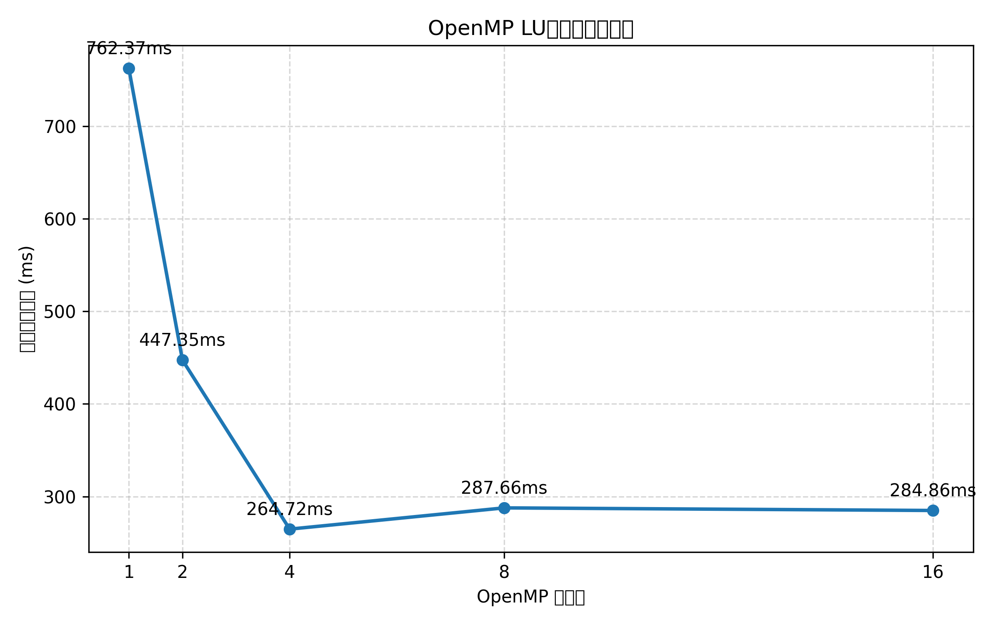
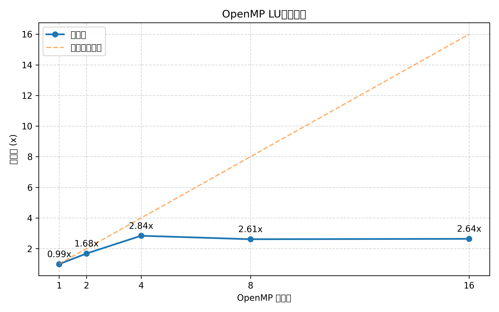
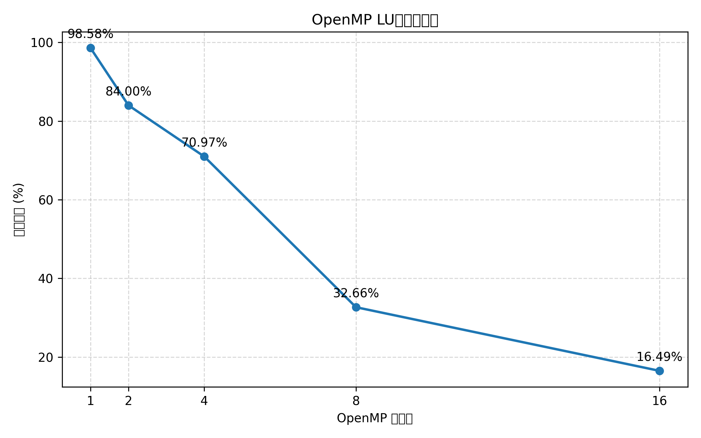

# LU 分解并行性能实验报告

## 1. 实验目的

本实验实现串行和 OpenMP 并行 LU 分解，重点分析 LU 三层循环中的数据依赖，确定可以并行化的循环，并比较不同线程数下的运行时间、加速比和并行效率。

## 2. 架构设计

项目采用通用框架和 LU 应用分层结构。`framework/` 提供算法接口、注册表和计时器；`lu/` 负责矩阵生成、LU 任务、算法实现和结果验证。

### 2.1 数据结构

矩阵使用方阵结构：

```c
typedef struct {
    int n;
    double *data;
} matrix;
```

LU 任务直接持有可修改的工作矩阵：

```c
typedef struct {
    matrix *a;
} lu_task;
```

每轮运行前，程序在计时开始前将原始矩阵复制到工作矩阵；算法随后直接在工作矩阵上原地完成 LU 分解。

### 2.2 模块职责

| 模块 | 职责 |
| --- | --- |
| `framework` | 提供算法接口、算法注册表和 `timer` |
| `matrix_init` | 生成强对角占优矩阵、复制矩阵和生成默认种子 |
| `serial_lu` | 执行串行无主元 LU 分解 |
| `openmp_lu` | 固定 `k` 后并行更新不同矩阵行 |
| `validate` | 将目标算法的 packed LU 与串行参考结果逐元素比较 |
| `main` | 解析参数、准备任务、计时、运行算法和输出结果 |

### 2.3 添加新的 LU 算法

新增算法时，只需要在 `lu/algorithms/` 增加实现文件，使用统一的 `kernel_fn` 接口，通过 `data->task` 获取 `lu_task`，并注册一个新的 `kernel_module`。输入生成、计时和验证流程无需重复实现。

## 3. LU 算法实现

### 3.1 Packed LU

程序采用无主元 LU 分解：

```text
A = L × U
```

分解结果保存在同一个工作矩阵中：

```text
C[i][j] = U[i][j]，当 i <= j
C[i][j] = L[i][j]，当 i > j
```

L 的对角线隐含为 1，不单独存储。

### 3.2 串行算法

串行算法执行原地高斯消元：

```text
for k = 0 ... N-1
    pivot = A[k][k]
    for i = k+1 ... N-1
        A[i][k] /= pivot
        for j = k+1 ... N-1
            A[i][j] -= A[i][k] × A[k][j]
```

### 3.3 OpenMP 算法

`k` 循环不能直接并行，因为第 `k+1` 步需要第 `k` 步更新后的矩阵数据。因此当前实现保持 `k` 串行，在固定 `k` 后并行 `i` 行，`j` 循环保持串行：

```c
for (int k = 0; k < n; ++k) {
    /* 计算当前主元 */

#pragma omp parallel for
    for (int i = k + 1; i < n; ++i) {
        /* 更新一整行 */
    }
}
```

每个线程负责不同的矩阵行，因此不会同时写入同一行。随着 `k` 增加，可并行的行数 `N-k-1` 逐渐减少，这是 LU 并行效率下降的重要原因。

## 4. 实验环境与配置

| 项目 | 配置 |
| --- | --- |
| 操作系统 | macOS 26.5.1（Build 25F80） |
| 系统内核 | Darwin 25.5.0 |
| 处理器 | Apple M5 Pro |
| 指令集架构 | ARM64 |
| 物理核心数 | 15 |
| 逻辑核心数 | 15 |
| 核心结构 | 两个性能层级，分别包含 5 个和 10 个核心 |
| 内存 | 24 GiB |
| 编程语言 | C99 |
| 编译器 | GCC 16.2.0 |
| OpenMP | 5.2（`_OPENMP=202111`） |
| 编译优化 | `-O2` |
| 矩阵规模 | `N = 2000` |
| 随机种子 | `ABCDEFGH` |
| 测试线程数 | 1、2、4、8、16 |
| 每个配置运行次数 | 5 次 |

输入矩阵由种子确定性生成。非对角元素取自 `[-0.5, 0.5]`，对角元素为该行非对角元素绝对值之和加 `1.0`，因此满足严格对角占优条件。

## 5. 实验过程

串行基线命令：

```bash
./build/bin/lu -m serial_lu -n 2000 -r 5 --seed ABCDEFGH
```

OpenMP 测试命令：

```bash
./build/bin/lu -m openmp_lu -n 2000 -r 5 -t 1 --seed ABCDEFGH
./build/bin/lu -m openmp_lu -n 2000 -r 5 -t 2 --seed ABCDEFGH
./build/bin/lu -m openmp_lu -n 2000 -r 5 -t 4 --seed ABCDEFGH
./build/bin/lu -m openmp_lu -n 2000 -r 5 -t 8 --seed ABCDEFGH
./build/bin/lu -m openmp_lu -n 2000 -r 5 -t 16 --seed ABCDEFGH
```

复制原始矩阵到工作矩阵的操作在计时开始前完成，计时区间只包含 LU 消元过程。程序还会在计时区间外使用 `serial_lu` 生成 packed LU 参考结果；所有目标算法的结果均与该串行参考结果逐元素比较，并通过正确性验证。

### 5.1 原始运行时间

| 配置 | 第 1 次（ms） | 第 2 次（ms） | 第 3 次（ms） | 第 4 次（ms） | 第 5 次（ms） | 平均（ms） |
|---|---:|---:|---:|---:|---:|---:|
| 串行 `serial_lu` | 751.180 | 750.308 | 752.014 | 752.064 | 752.020 | **751.517** |
| OpenMP，1 线程 | 760.013 | 761.603 | 763.035 | 761.340 | 765.847 | **762.368** |
| OpenMP，2 线程 | 445.627 | 448.016 | 448.635 | 446.997 | 447.466 | **447.348** |
| OpenMP，4 线程 | 266.118 | 265.204 | 262.549 | 266.879 | 262.840 | **264.718** |
| OpenMP，8 线程 | 283.669 | 287.681 | 288.703 | 289.483 | 288.759 | **287.659** |
| OpenMP，16 线程 | 284.932 | 283.602 | 285.557 | 285.863 | 284.347 | **284.860** |

平均运行时间如图 1 所示。



## 6. 加速比与并行效率

以串行 `serial_lu` 平均时间 `T₁=751.517 ms` 为基线：

```text
Speedup(p) = T₁ / Tₚ
Efficiency(p) = Speedup(p) / p
```

| 配置 | 平均时间（ms） | 加速比 | 并行效率 |
|---|---:|---:|---:|
| 串行 `serial_lu` | 751.517 | 1.000 | 100.00% |
| OpenMP，1 线程 | 762.368 | 0.986 | 98.58% |
| OpenMP，2 线程 | 447.348 | 1.680 | 84.00% |
| OpenMP，4 线程 | 264.718 | 2.839 | 70.97% |
| OpenMP，8 线程 | 287.659 | 2.613 | 32.66% |
| OpenMP，16 线程 | 284.860 | 2.638 | 16.49% |

图 2 展示实际加速比与理想线性加速的差异。



图 3 展示并行效率随线程数的变化。



## 7. 结果分析

### 7.1 运行时间变化

2 线程和 4 线程分别将平均时间降低到 `447.348 ms` 和 `264.718 ms`。但是继续增加线程后，8 线程平均时间上升到 `287.659 ms`，16 线程为 `284.860 ms`，没有继续获得收益。

### 7.2 加速比与效率

4 线程取得最高加速比 `2.839` 和最高并行效率 `70.97%`。8 和 16 线程的加速比反而略低，效率分别下降到 `32.66%` 和 `16.49%`。

### 7.3 线程扩展表现

LU 的性能没有随线程数单调提升。原因在于 `k` 循环必须串行，而固定 `k` 后可并行的行数会逐步减少。后半段消元步骤中，并行任务数量不足以充分利用更多线程，但每轮 OpenMP 并行区域仍然需要承担调度和同步开销。

## 8. 性能瓶颈讨论

### 8.1 循环携带依赖

第 `k+1` 步依赖第 `k` 步更新后的矩阵，因此无法直接并行 `k` 循环。这构成了 LU 并行化的主要限制。

### 8.2 并行规模收缩

第 `k` 步只有 `N-k-1` 行可以并行更新。随着 `k` 增大，部分线程会逐渐空闲，线程数越多，后期资源浪费越明显。

### 8.3 OpenMP 调度和同步开销

当前实现对每个 `k` 都进入一次 `parallel for`。当剩余行数较少时，创建或调度并行区域、线程同步等成本可能超过实际计算收益。

### 8.4 硬件并行资源

本机有 15 个逻辑核心，16 线程已经超过硬件可同时执行的逻辑核心数，可能产生资源竞争。这可以解释 16 线程效率进一步下降，但 8 线程变慢的主要原因仍然是 LU 的并行任务收缩和同步成本。

## 9. 结论

本实验实现了无主元串行 LU 和固定 `k` 后并行行更新的 OpenMP LU。所有并行配置生成的 packed LU 均与串行参考结果一致并通过正确性验证。

在本次实验中，4 线程取得最佳性能：平均时间 `264.718 ms`，加速比 `2.839`，并行效率 `70.97%`。8 和 16 线程没有继续提升性能，说明 LU 的循环依赖和逐步收缩的并行规模对扩展性形成了明显限制。
