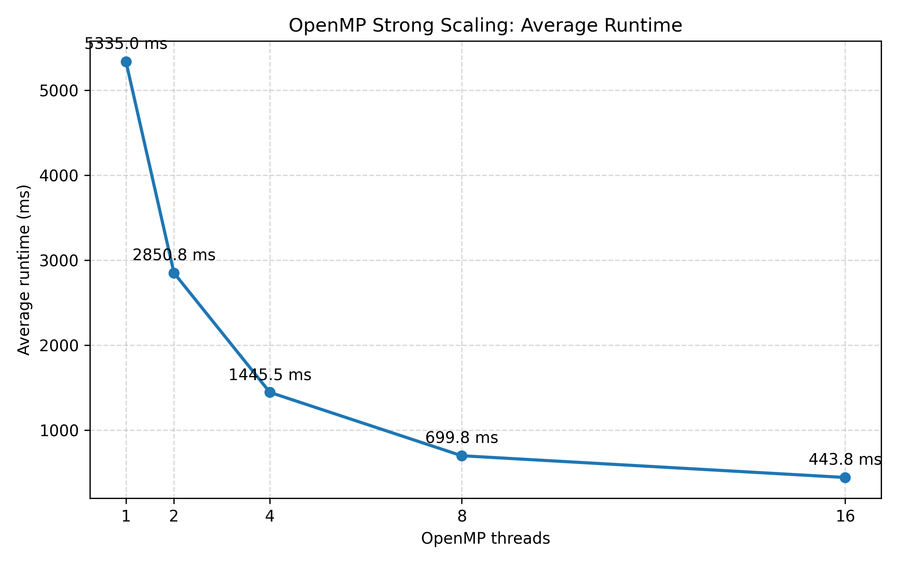
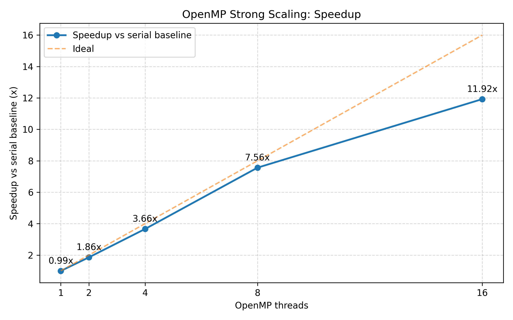
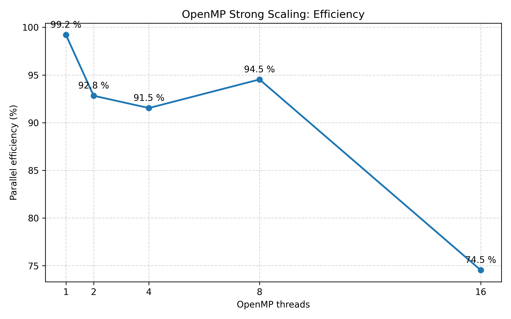

# 并行矩阵乘法性能实验报告

231502003 邵祥瑞

## 1. 实验目的

本实验实现矩阵乘法程序，并使用 OpenMP 将串行矩阵乘法并行化，通过固定问题规模、重复测量和性能指标计算，对并行程序的实际收益进行分析。

## 2. 架构设计

项目整体结构分为两部分，通用框架 `framework/` 和矩阵乘法实验部分 `matmul/`。 

### 2.1 通用框架

通用框架代码包含目标无关的算法接口、注册表和计时器。

`framework/include/kernel.h` 定义统一的算法调用接口，通过不透明的 `task` 指针接收目标任务：

```c
typedef struct {
    void *task;
    void *workspace;
} kernel_data;
```

`registry` 模块负责注册、查找和列出算法，它把注册新算法与算法具体执行过程解耦，使得目标任务代码可以比较方便的扩展支持的算法。

`timer` 模块使用结构体保存开始和结束时间，并提供 `timer_start()`、`timer_stop()` 和时长读取接口。

### 2.2 矩阵乘法

矩阵乘法的数据类型定义为 `matrix` ：它的秩为 n，使用 n * n 的二维数组存储。

```c
typedef struct {
    int n;
    double *data;
} matrix;
```

一次矩阵乘法任务由两个输入矩阵和一个输出矩阵组成：

```c
typedef struct {
    const matrix *a;
    const matrix *b;
    matrix *c;
} matmul_task;
```

各模块的职责如下：

| 模块 | 职责 |
| --- | --- |
| `cli` | 解析命令行参数 |
| `input` | 获取输入矩阵 |
| `matrix` | 矩阵定义 |
| `algorithms` | 算法实现 |
| `validate` | 正确性验证 |

### 2.3 执行流程

```text
注册算法
    ↓
解析命令行参数
    ↓
读取或生成输入矩阵 A、B
    ↓
创建 matmul_task
    ↓
使用串行算法生成参考结果
    ↓
运行目标算法并计时
    ↓
验证结果
```

## 3. 程序实现

### 3.1 串行算法

串行基线使用三重循环计算矩阵乘法：

```text
for i = 0 ... N-1
    for j = 0 ... N-1
        C[i][j] = 0
        for k = 0 ... N-1
            C[i][j] += A[i][k] × B[k][j]
```

### 3.2 OpenMP 算法

OpenMP 实现对输出矩阵的外层 `i` 循环进行并行化，通过命令行参数 `-t` 指定线程数。

## 4. 实验环境与配置

| 项目 | 配置 |
| --- | --- |
| 操作系统 | macOS 26.5.1（Build 25F80） |
| 系统内核 | Darwin 25.5.0 |
| 处理器 | Apple M5 Pro |
| 指令集架构 | ARM64 |
| 物理核心数 | 15 |
| 逻辑核心数 | 15 |
| 核心结构 | 两个性能层级，分别包含 5 个和 10 个核心 |
| 内存 | 24 GiB |
| 编程语言 | C99 |
| 编译器 | GCC 16.2.0 |
| 并行接口 | OpenMP 5.2（`_OPENMP=202111`） |
| 构建工具 | CMake 4.4.3 |
| 编译优化 | `-O2` |
| 矩阵规模 | `N = 2000`，即 `2000 × 2000` |
| 输入方式 | A、B 均使用随机生成矩阵 |
| 随机种子 | `ABCDEFGH` |
| 测试线程数 | 1、2、4、8、16 |
| 每个配置运行次数 | 5 次 |

本实验采用固定随机种子，使每个线程配置使用相同的输入矩阵。

构建命令为：

```bash
cmake -S . -B build -DCMAKE_C_COMPILER=/opt/homebrew/bin/gcc-16
cmake --build build --target matmul
```

运行程序位于：

```text
./build/bin/matmul
```

## 5. 实验过程

实验固定问题规模 `N=2000`，通过改变参与计算的线程数，比较不同线程配置下的运行时间、加速比和并行效率。

### 5.1 串行基线

首先使用 `naive` 算法建立串行基线。通过一条独立命令连续运行 5 次：

```bash
./build/bin/matmul -m naive -n 2000 -r 5 --seed ABCDEFGH
```

得到的原始运行时间如下：

| 运行次数 | 时间（ms） |
|---:|---:|
| 1 | 5340.441 |
| 2 | 5291.509 |
| 3 | 5252.488 |
| 4 | 5273.239 |
| 5 | 5303.682 |
| **平均** | **5292.272** |

因此本实验采用：

```text
T₁ = 5292.272 ms
```

### 5.2 OpenMP 并行测试

随后分别使用 1、2、4、8、16 个线程运行 OpenMP 算法。每个线程配置使用一条独立命令连续运行 5 次：

```bash
./build/bin/matmul -m openmp -n 2000 -r 5 -t 1  --seed ABCDEFGH
./build/bin/matmul -m openmp -n 2000 -r 5 -t 2  --seed ABCDEFGH
./build/bin/matmul -m openmp -n 2000 -r 5 -t 4  --seed ABCDEFGH
./build/bin/matmul -m openmp -n 2000 -r 5 -t 8  --seed ABCDEFGH
./build/bin/matmul -m openmp -n 2000 -r 5 -t 16 --seed ABCDEFGH
```

所有测试均使用同一个随机种子，结果验证均通过。记录的原始时间和平均值如下：

| 线程数 | 第 1 次（ms） | 第 2 次（ms） | 第 3 次（ms） | 第 4 次（ms） | 第 5 次（ms） | 平均（ms） |
|---:|---:|---:|---:|---:|---:|---:|
| 1 | 5318.688 | 5292.317 | 5315.533 | 5368.517 | 5379.806 | **5334.972** |
| 2 | 2858.189 | 2838.390 | 2856.588 | 2838.910 | 2861.993 | **2850.814** |
| 4 | 1454.377 | 1440.073 | 1439.322 | 1444.808 | 1449.020 | **1445.520** |
| 8 | 701.008 | 700.064 | 698.997 | 701.234 | 697.809 | **699.822** |
| 16 | 440.306 | 443.585 | 447.203 | 445.144 | 442.913 | **443.830** |

平均运行时间随线程数的变化如图 1 所示。线程数增加后运行时间持续下降，但 8 到 16 线程之间的下降幅度已经小于理想减半。



## 6. 加速比与并行效率

### 6.1 计算公式

以串行 `naive` 的平均时间作为基线，线程数为 `p` 时的平均运行时间记为 `Tₚ`。

加速比为：

```text
Speedup(p) = T₁ / Tₚ
```

并行效率为：

```text
Efficiency(p) = Speedup(p) / p * 100%
```

### 6.2 计算结果

| 配置 | 平均时间（ms） | 加速比 | 并行效率 |
|---:|---:|---:|---:|
| 串行基线 | 5292.272 | 1.000 | 100.00% |
| OpenMP，1 线程 | 5334.972 | 0.992 | 99.20% |
| OpenMP，2 线程 | 2850.814 | 1.856 | 92.82% |
| OpenMP，4 线程 | 1445.520 | 3.661 | 91.53% |
| OpenMP，8 线程 | 699.822 | 7.562 | 94.53% |
| OpenMP，16 线程 | 443.830 | 11.924 | 74.53% |

图 2 将实测加速比与理想线性加速进行比较。1 到 8 线程的实测曲线较接近理想线，16 线程时偏离明显增大。



图 3 展示并行效率。2、4、8 线程时效率均超过 90%，16 线程时下降到 74.53%。



## 7. 结果分析

### 7.1 运行时间变化

随着线程数增加，平均运行时间整体下降：

- 1 线程：`5334.972 ms`；
- 2 线程：`2850.814 ms`，约降为 1 线程的 53.4%；
- 4 线程：`1445.520 ms`，继续接近减半；
- 8 线程：`699.822 ms`，仍然保持明显收益；
- 16 线程：`443.830 ms`，继续下降，但相对于 8 线程的收益明显减小。

从 1 到 8 线程，运行时间下降趋势接近理想的线性缩短；从 8 增加到 16 线程后，平均时间只从 `699.822 ms` 降到 `443.830 ms`，降幅约为 36.6%，明显低于理想的 50%。

### 7.2 加速比变化

加速比从 2 线程的 `1.856` 增加到 16 线程的 `11.924`，说明增加线程确实带来了显著的性能收益。

在 2、4、8 线程时，加速比分别为 `1.856`、`3.661` 和 `7.562`，已经比较接近理想值 2、4 和 8。16 线程时理想加速比为 16，而实际加速比为 `11.924`，偏离程度明显增大。

### 7.3 并行效率变化

2、4、8 线程的效率分别为 `92.82%`、`91.53%` 和 `94.53%`，说明在这些线程配置下，计算任务能够较好地分摊到多个线程上。

在多线程配置中，8 线程的并行效率最高，但与 2、4 线程差距并不大。这可能与线程调度、动态频率、缓存状态和测量波动等因素相关。

16 线程效率下降到 `74.53%`。本机只有 15 个逻辑核心，16 个 OpenMP 线程已经超过硬件可同时执行的逻辑核心数，可能产生额外的线程调度和资源竞争。这与 16 线程配置下效率明显下降的现象相符。

### 7.4 线程扩展表现

在固定矩阵规模的条件下，实验结果表明：

- 在 1 到 8 线程范围内，运行时间近似随线程数增加而下降；
- 16 线程仍然能够提升性能，但已经出现效率下降和加速比偏离线性增长的现象；
- 在本次测试平台上，16 线程的绝对运行时间最低，但 8 线程具有更高的并行效率。

如果目标是最短运行时间，应选择 16 线程；如果同时考虑资源利用率和性能收益，8 线程可能是更均衡的配置。

## 8. 性能瓶颈讨论

### 8.1 并行与同步开销

线程数量增加后，需要付出线程创建、调度和并行区域同步的成本。在线程数较少时，矩阵乘法的计算量足够大，这些开销相对较小；在线程数增加后，单位线程分配到的计算量减少，这些开销的相对比例会上升。

### 8.2 内存访问与缓存竞争

矩阵乘法需要反复访问 A、B 和 C。多个线程同时访问共享内存和缓存系统，可能产生缓存容量压力、缓存竞争和内存带宽压力。

### 8.3 有限的硬件并行资源

可用的物理核心数、硬件线程数和处理器调度都会限制进一步扩展。本机共有 15 个物理核心和 15 个逻辑核心，并且包含两个不同的核心性能层级。线程可能被调度到性能特征不同的核心上，因此线程数增加与计算能力增加并不一定保持完全线性。

实验中的 16 线程配置超过了本机逻辑核心数。此时至少有两个软件线程需要竞争同一个时刻的硬件执行资源，线程切换和资源竞争会增加，可能是 16 线程并行效率下降的重要原因。
